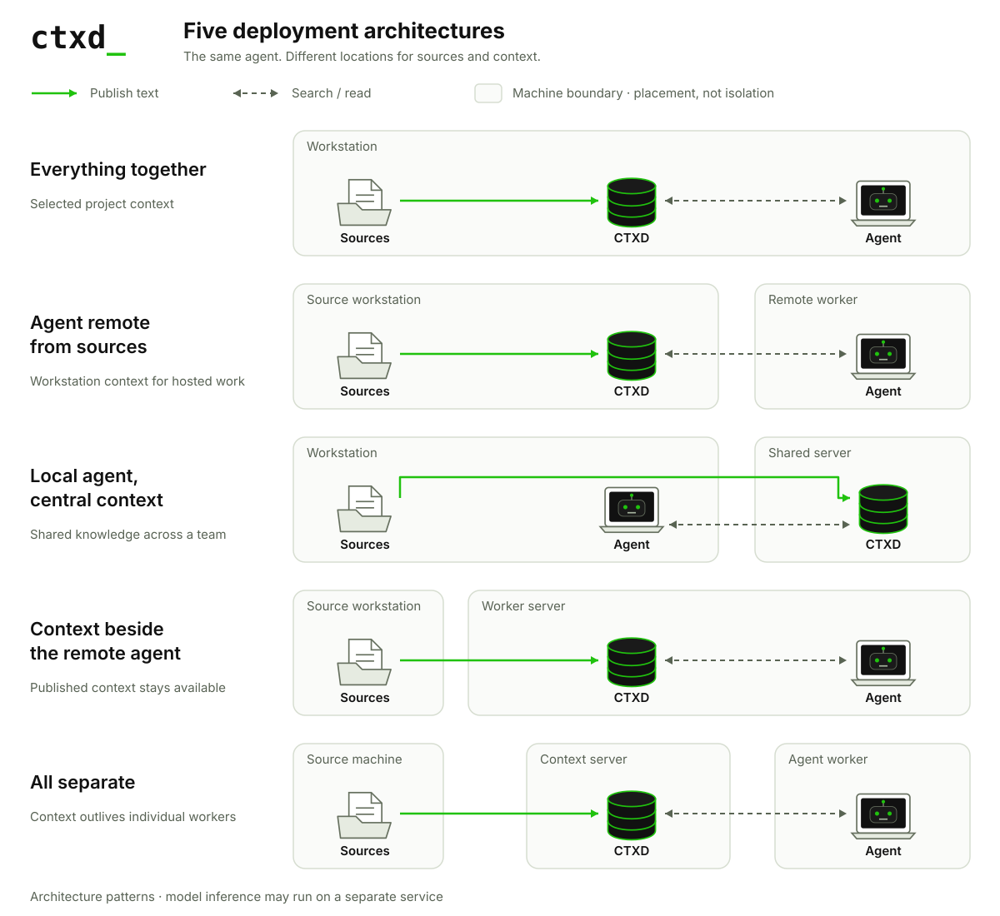

# CTXD examples

Connect agents to the context they need—on a workstation, beside a remote worker, or through a shared service.

CTXD separates context ingestion from agent execution. A producer publishes selected text to ctxfs, CTXD's context store. Agents search and read that text through a common interface, independently of where the original files live.

The CTXD support assistant answers setup, integration, and troubleshooting questions using official documentation synced from GitHub. Its HTML interface shows retrieved evidence and citations to a specific source revision. Two Docker containers separate the application from its documentation and context store; four further architectures scope alternative placements.

[Explore the agent exemplar](examples/README.md) · [Migrate an existing context backend](.agents/skills/migrate-context-to-ctxd/README.md)

**Try it:** [Obtain your own Gemini key](examples/README.md#obtain-your-own-gemini-api-key), put it in a private `.env`, and [run the example](examples/README.md#run-the-example). Visitors use the operator’s shared allowance, with persistent usage limits. Documentation browsing works without a model key.

## Deployment architectures

A documentation checkout or exported collection lives on the source machine. The agent and CTXD locations vary. Each architecture links to a support scenario; Docker containers represent the machine boundaries in the runnable remote-agent example.

**Agent on the source workstation**

| Architecture / example | CTXD location | Main benefit |
|---|---|---|
| [Everything together](examples/README.md#everything-together) | Same workstation | Access to selected project files. |
| [Local agent, central context](examples/README.md#local-agent-central-context) | Separate server | Reuse shared team knowledge. |

**Agent on a remote worker**

| Architecture / example | CTXD location | Main benefit |
|---|---|---|
| [Agent remote from sources](examples/README.md#agent-remote-from-sources) | Source workstation | Read workstation context remotely. |
| [Context beside the remote agent](examples/README.md#context-beside-the-remote-agent) | Worker server | Answer questions while the source is offline. |
| [All separate](examples/README.md#all-separate) | Dedicated server | Replace workers without rebuilding context. |

For **everything together**, restricted file access requires an isolated agent and a store containing only its approved material. CTXD does not prevent an agent from bypassing the service if that agent can read the surrounding filesystem. Existing scoped file tools may already meet this need.

A **central context service** is useful when readers share a corpus, producers contribute from different machines, or storage outlives individual workers. Direct reads are usually simpler for an agent that only needs files already available on its own workstation.

The [example guide](examples/README.md#architecture-guide) describes the task, expected behavior, and alternative for each layout. The [Docker environment guide](examples/README.md#docker-environments) defines the simulated connections and configuration boundaries.

## How integration works

A tracker reads supported files and submits their text and metadata to ctxfs. Original files remain in place; the context store holds a served copy. Application records require an export or producer, and unsupported media requires text extraction.

The agent searches and reads through MCP, SDK, CLI, or REST. Its model and application tools turn the retrieved evidence into an answer, review, or other result. The model may run on another service even when the agent and its context tools run on the workstation.

## Architecture notes

These contracts describe the standalone Python implementation at [CTXD revision `3289b13`](https://github.com/ctxd-dev/ctxd/tree/3289b13092f9bda0622dc65d005cedd9fc84316e).

- **Sources and synchronization.** The tracker accepts selected UTF-8 text formats up to 5,000,000 bytes per file. Updates and removals become visible after successful synchronization. Tracking exported files does not refresh their upstream application. See the [tracker implementation](https://github.com/ctxd-dev/ctxd/blob/3289b13092f9bda0622dc65d005cedd9fc84316e/src/ctxd/tracker.py).
- **Retrieval and evidence.** The tools are `ls`, `tree`, `glob`, `stat`, `read`, `read_lines`, and `grep`. They provide navigation, lexical matching, and bounded reads. Preserve completeness indicators and available read hashes when building citations; a complete read does not prove complete ingestion. Semantic retrieval and live APIs can complement these tools. See the [MCP tools](https://github.com/ctxd-dev/ctxd/blob/3289b13092f9bda0622dc65d005cedd9fc84316e/src/ctxd/mcp_server.py) and [response models](https://github.com/ctxd-dev/ctxd/blob/3289b13092f9bda0622dc65d005cedd9fc84316e/src/ctxfs/models.py).
- **Availability and consistency.** A reachable store can serve previously submitted text while its producer is offline. An unavailable store requires an application-provided fallback. Reproducible jobs need a defined input snapshot; normalized content hashes alone do not provide a consistent snapshot across documents.
- **Readers and writers.** Standalone readers can read the whole store. Submission credentials can be restricted by prefix. Private collections require isolated stores or an enforced access layer; applications using several stores handle routing. See the [authorization policy](https://github.com/ctxd-dev/ctxd/blob/3289b13092f9bda0622dc65d005cedd9fc84316e/src/ctxfs/auth.py).
- **Agent responsibilities.** The application supplies the model, interface, task state, schedules, action tools, and memory policy. Context synchronization does not start agent tasks. Retrieved passages can also appear in model requests and application logs.

Network deployments require a reachable endpoint and authentication. Non-loopback serving requires explicit opt-in and TLS; follow the [server deployment guide](https://github.com/ctxd-dev/ctxd/blob/3289b13092f9bda0622dc65d005cedd9fc84316e/docs/ctxfs-secure-server.md).

**Version compatibility:** The Python `0.1.16` [release implementation](https://github.com/ctxd-dev/ctxd/blob/7ac8fef0d337276187b9cac2e690acd396941e70/src/ctxd/local_ctxfs_server.py) predates the authenticated network server described here. The Python adapter and [npm bridge](https://github.com/ctxd-dev/ctxd-mcp) also share the executable name `ctxd-mcp` while exposing different contracts. Pin the exact artifact and verify its tools before deployment.

## Migrate an existing application

The repository includes **`migrate-context-to-ctxd`**, a skill for adapting an existing application's context ingestion and retrieval. It checks compatibility, implements a reversible adapter, compares representative tasks against the original provider, and verifies rollback.

The [skill README](.agents/skills/migrate-context-to-ctxd/README.md) explains supported inputs, invocation, and expected results. Its [agent instructions](.agents/skills/migrate-context-to-ctxd/SKILL.md) are stored in the repository and require no global installation.
