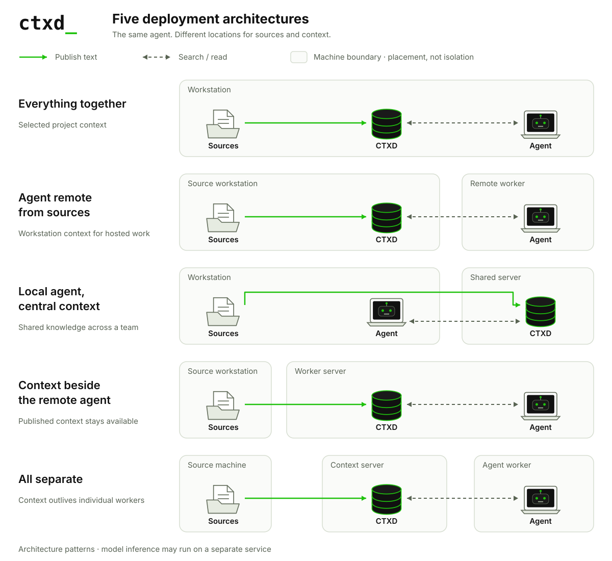

# CTXD support assistant

Ask how to integrate CTXD, connect a remote agent, or diagnose synchronization and authentication problems. The assistant retrieves official documentation through CTXD, generates a bounded answer, and links citations to the GitHub revision it read.

The application runs in two Docker containers. The **data container** syncs the public documentation from [ctxd-dev/ctxd](https://github.com/ctxd-dev/ctxd), publishes it to CTXD. The **web container** serves the interface, retrieves passages, applies usage limits, and makes one Gemini generation request per uncached answer. The model runs outside Docker.

## Run the example

On the development workstation that will run Docker, as the checkout owner with Docker access, run from the repository root:

```sh
cp -n .env.example .env
chmod 600 .env
```

### Obtain your own Gemini API key

Every operator running a copy of this application supplies their own key. Visitors to that instance use its shared allowance and do not enter credentials.

1. On your own workstation, sign in to [Google AI Studio](https://aistudio.google.com/apikey) with your Google account.
2. Create an API key in a project eligible for Gemini's free tier. Keep the project on the free tier for free-tier testing; connecting a billing account changes its billing status.
3. On the Docker workstation, edit `.env` and set `GEMINI_API_KEY` to the key. Do not paste the key into the chat interface, commit it, or include it in screenshots.
4. Check the project's [active rate limits](https://aistudio.google.com/rate-limit) and set `MODEL_RPM`, `MODEL_RPD`, and `MODEL_TPM` below those allowances, accounting for any other application using the same project.

The default model is Gemini 3.5 Flash-Lite. Google lists a free tier for it, with account-specific limits. Free-tier prompts and answers may be used to improve Google's products; use public documentation and avoid credentials or private diagnostic data in questions. A shared API key does not provide unlimited free capacity. See [Gemini pricing](https://ai.google.dev/gemini-api/docs/pricing) and [billing](https://ai.google.dev/gemini-api/docs/billing).

`.env` is ignored by Git and excluded from Docker build contexts. Compose passes the key only to the web container at runtime. Docker-authorized administrators can inspect container environment values, so access to the Docker host remains privileged.

On the Docker workstation as its Docker-authorized account, from the repository root:

```sh
docker compose up --build -d --wait
```

Open `http://127.0.0.1:8840` in a browser on that workstation. To access it from another authorized workstation, set `WEB_BIND` to a reachable interface on the Docker host before starting Compose. The data service has no published host port. Initial startup requires GitHub access.

If the key is absent, documentation browsing works and the interface explains that AI answers are unavailable. After changing the key or model in `.env`, run on the Docker workstation as its Docker-authorized account:

```sh
docker compose up -d web
```

Do not print `docker compose config` when sharing diagnostics: its expanded output can include the key.

## Try the assistant

| Question | Useful answer |
|---|---|
| How do I install CTXD and connect my agent? | Supported setup steps and integration guidance with citations. |
| The CLI works, but my remote agent gets 401. | Distinguish socket trust from network authentication and identify checks on the reader and server. |
| My files changed, but my agent sees old content. | Check tracker health, successful synchronization, and the paths being read. |

Selecting a suggested question starts the conversation immediately. The chat interface provides conversation history in the sidebar, Markdown and code formatting, copy controls, an animated waiting indicator, and a visible Stop button. Answers appear word by word once generation completes; Stop also cancels this reveal. The reduced-motion preference displays answers immediately. Answers link to cited lines; **View evidence** opens retrieved passages and the source revision. **Documentation** opens the document browser independently of AI answers. The default CTXD theme uses near-black surfaces, green accents, Inter text, and a JetBrains Mono wordmark. A light theme is available in settings.

Follow-up questions carry a bounded recent conversation held in tab memory. **New chat** starts a separate conversation, and the sidebar switches between chats. Reloading the page clears them. The application does not save general conversations or questions to disk.

The interface uses [assistant-ui](https://github.com/assistant-ui/assistant-ui) (MIT), React, and [Lucide](https://lucide.dev) icons. Vite builds the interface inside Docker; the Python web service serves the bundle, so no additional runtime container is required. **Settings → Open-source licenses** includes the bundled dependencies' license notices.

A complete answer has citations within the supplied ranges and read hashes that still match afterward. These checks do not prove that the answer's interpretation is correct. Unverified citations, changed evidence, and incomplete model output produce a partial answer. Model or data outages produce an explicit failure; documentation browsing remains available whenever the data service is reachable.

## Documentation synchronization

The producer fetches the repository's default branch every five minutes. It selects the root README and Markdown pages under `docs/public`, validates the inventory, publishes additions and removals, and verifies published hashes before announcing a revision. A failed upstream check retains the last verified publication and shows a synchronization warning.

The data volume retains fetched revisions, publication metadata, credentials, and CTXD storage. The web container has no source checkout, CTXD storage mount, or writer credential. CTXD requests between containers use TLS and a reader credential.

| Setting | Default | Purpose |
|---|---|---|
| Documentation revision | HEAD | Follow the repository's default branch; set `DOCS_REF` to a commit to pin it. |
| Sync interval | 300 seconds | Set `SYNC_SECONDS` to change polling; minimum 60 seconds. |

To check GitHub immediately, run on the Docker workstation as its Docker-authorized account, from the repository root:

```sh
docker compose exec data python data_service.py sync
```

A new GitHub revision changes the cache identity. In-flight reads are checked against their expected hashes; inconsistent evidence is rejected rather than silently mixed.

## Shared usage limits

These defaults are application policies. They are not Google's published quota for a particular account.

| Boundary | Default policy |
|---|---|
| Visitor IP address | 5 questions per rolling 10 minutes; 20 per rolling 24 hours |
| Global model requests | 3 per rolling minute; 50 per rolling 24 hours |
| Global token reservation | 60,000 per rolling minute, conservatively reserved from serialized request bytes plus headroom |
| Work in flight | One generation; up to three waiting requests, with a 20-second queue wait |
| Input and output | 1,200-character question, bounded recent history and passages, 24 KB serialized model request, 800 output-token ceiling |
| Provider failures | No automatic retry; a 429 temporarily blocks subsequent model calls |
| Curated questions | Verified complete answers cached for up to 24 hours by question, revision, model, and prompt version |

Usage counters, the global generation lease, cooldowns, and the small curated-answer cache persist in the web container's usage volume. Counters reserve capacity before contacting Gemini and retain the reservation on errors or cancellation, when provider usage may be uncertain. Clearing browser storage or restarting the web container does not reset them. Provider-enforced limits still apply; token reservations are conservative estimates rather than measurements from an additional token-counting request.

Visitor identity uses a salted hash of the client IP address. With Cloudflare protecting the public page, the application uses [CF-Connecting-IP](https://developers.cloudflare.com/fundamentals/reference/http-headers/#cf-connecting-ip) from a configured trusted proxy; direct development requests use the connecting address. People on one network can share an allowance, and IP limits alone cannot prevent distributed abuse. The global limits cap this instance's model requests. Other clients using the same Google project consume that project's quota independently.

Proxy headers are ignored by default. `TRUSTED_PROXY_NETWORKS` should contain only the actual trusted Cloudflare tunnel proxy addresses, and only when the origin cannot be reached by untrusted clients through those addresses. Otherwise, keep it empty; a proxied deployment may share one visitor allowance. Do not broadly trust forwarded headers on a publicly reachable origin.

## Docker environments

The runnable architecture is **agent remote from sources**. Compose starts two containers, with a private context network and separate outbound access for GitHub synchronization and model requests. The browser connects to the web container's published port.

| Resource | Placement |
|---|---|
| Original documentation and publication | Data container and its persistent volume |
| CTXD context store | Data container |
| Interface, retrieval, quotas, answer generation | Web container |
| Quota counters and curated cache | Web usage volume |
| Gemini key | Operator's `.env`; web-container environment |
| Model inference | Gemini API |

To exercise an outage, run on the Docker workstation as its Docker-authorized account, from the repository root:

```sh
docker compose stop data
```

The interface remains reachable and reports that documentation is unavailable. Restart the data container on the same workstation and account:

```sh
docker compose start data
```

`docker compose down` stops the example while retaining its named volumes. Docker simulation establishes service boundaries, not production availability across physical machines.

## Architecture guide



The same support task can exercise five placements. Only the remote-agent deployment is packaged in Compose; the other arrangements are implementation scopes.

### Everything together

**Placement:** Documentation checkout, publisher, CTXD, and assistant share one workstation.

**Value:** Reuse one maintained documentation collection across tools. Direct scoped file reads are also a reasonable alternative at this size.

**Implementation scope:** Co-locate the existing processes and demonstrate that the assistant uses only the approved collection. Process permissions determine whether it can bypass the service.

### Agent remote from sources

**Placement:** Documentation checkout, publisher, and CTXD share the data container; the assistant runs in the web container.

**Value:** Refresh support knowledge independently of the web application, with bounded reads and revision-linked citations. A remote documentation API is an alternative.

**Working example:** Ask a setup question, inspect retrieved evidence, and exercise a data-service outage.

### Local agent, central context

**Placement:** Checkout, publisher, and assistant share a workstation; CTXD runs on a separate server.

**Value:** Several contributors and assistants reuse a maintained collection. Shared storage or an existing retrieval service can also serve this purpose.

**Implementation scope:** Move the assistant beside the publisher, retain network reads, and verify that another authorized reader sees the same publication.

### Context beside the remote agent

**Placement:** Checkout and publisher run on the source workstation; CTXD and the assistant run on the worker.

**Value:** Continue answering from the published documentation while the source workstation is offline. A synchronized documentation bundle is an alternative.

**Implementation scope:** Move CTXD storage beside the assistant, stop the source service, and demonstrate successful reads with an explicit publication revision.

### All separate

**Placement:** Checkout and publisher, CTXD, and the assistant occupy three separate services.

**Value:** Replace assistant workers independently of ingestion and storage. An existing shared retrieval API is an alternative.

**Implementation scope:** Separate the producer and store, then replace the assistant while retaining the published collection. Shared quota state must remain authoritative if multiple web replicas are introduced.

## Deployment path

The same Compose deployment can run on a hosted Linux machine with persistent disks. A stable Cloudflare Tunnel can provide HTTPS while only the web application is exposed. Move the `.env` secret through an operator-controlled mechanism, back up the data and usage volumes, and verify trusted proxy handling before admitting public visitors.

A temporary test tunnel can be started on the Docker workstation, as the account running `cloudflared`, when Compose uses its default loopback binding:

```sh
cloudflared tunnel --url http://127.0.0.1:8840
```

Anyone with the generated URL can use the shared allowance. The containers remain on the Docker workstation, and the URL ends when the tunnel stops. [Quick Tunnels](https://developers.cloudflare.com/tunnel/get-started/quick-tunnels/) have no uptime guarantee. The app uses newline-delimited JSON streaming.

Hosting directly in [Cloudflare Containers](https://developers.cloudflare.com/containers/) requires a Workers Paid plan, container routing, and explicit persistence. Its disks are [ephemeral by default](https://developers.cloudflare.com/containers/faq/#is-disk-persistent-what-happens-to-my-disk-when-my-container-sleeps). This repository supplies Compose deployment, not Cloudflare-hosted container configuration.

## Verify the implementation

On the development workstation as the checkout owner, from the repository root, with Python 3.11 or 3.12:

```sh
python3.12 -m venv .venv
.venv/bin/pip install -r examples/context-agent/requirements.txt
.venv/bin/pytest -q
```

Tests use authenticated CTXD services, a temporary Git upstream, and simulated Gemini responses. They cover synchronization, updates and removals, retained publications, citation validation, quota persistence and concurrency, provider failures, and cancellation. Live answer quality requires a configured Gemini key.

On the development workstation as the checkout owner, from the repository root, with Node.js 22.12 or later:

```sh
npm ci --prefix examples/context-agent/web
npm test --prefix examples/context-agent/web
npm run build --prefix examples/context-agent/web
```

The chat adapter checks cover bounded follow-up history, split stream events, citation links, and quota errors. Docker builds the same frontend bundle automatically.

With Compose running, run on the Docker workstation as its Docker-authorized account, from the repository root:

```sh
python3 examples/context-agent/tests/check_docker.py http://127.0.0.1:8840
```

This check reads CTXD through TLS, verifies source isolation and quota-volume persistence, and stops and restores the data container. Run it on a development instance without active conversations. Supply the actual web address if its binding differs.

The [repository migration skill](../.agents/skills/migrate-context-to-ctxd/README.md) uses the same reversible context boundary when adapting another application.
